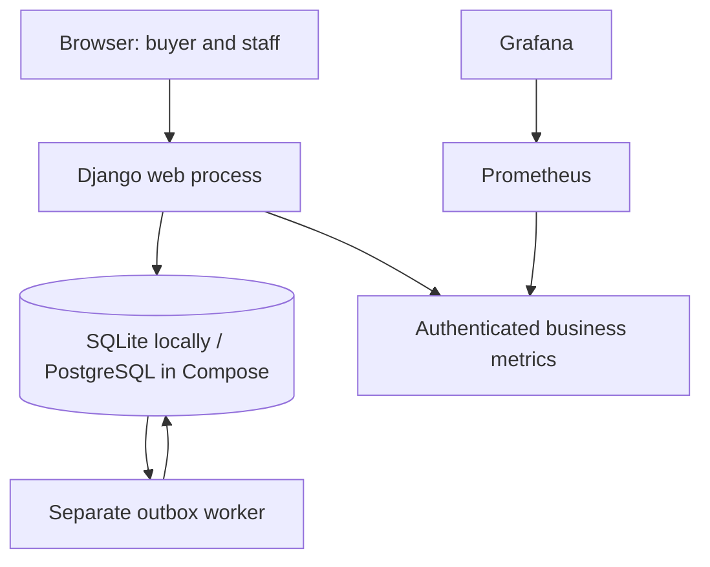
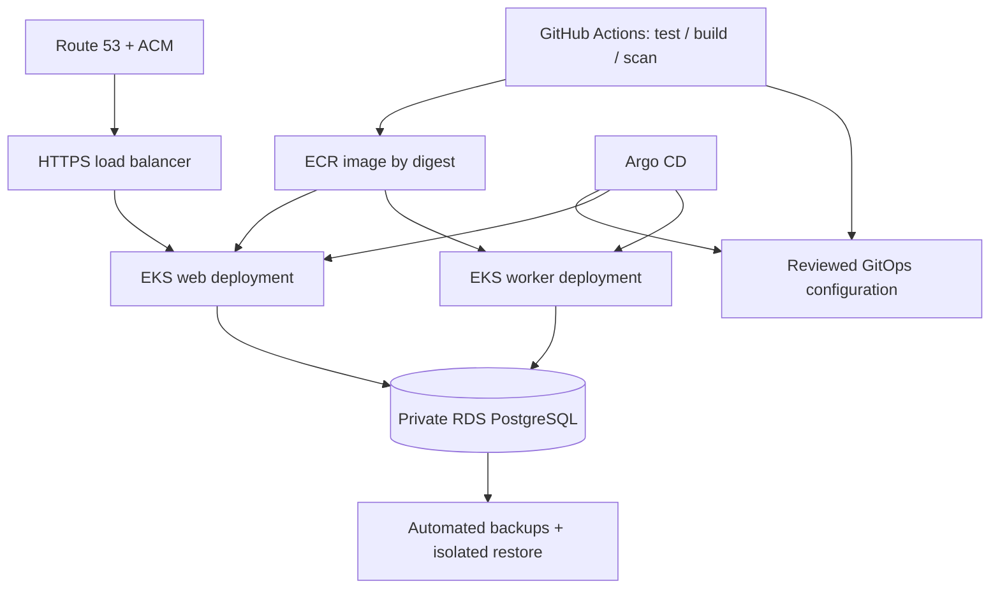

# Architecture and trade-offs

## Running application

The database stores orders and outbox jobs atomically. The worker polls the database; it does not consume a second broker. Web and worker use the same versioned image with different commands. The database schema is migrated by a separate job.

## Planned AWS architecture — not provisioned

Private subnets, security groups, least-privilege workload identities, Secrets Manager, encrypted storage, separate environment boundaries and managed access will be designed before Terraform apply. Local PostgreSQL 18.6 does not establish RDS regional availability; verify the target RDS version when choosing region and planning deployment. Terraform/EKS/Helm/Argo implementation remains behind the phase gates.

## ADR 001: one codebase, separate web and worker
Django supplies maintained authentication, CSRF, ORM migrations and templates. Server-rendered pages keep browser setup light on WSL while preserving a real authenticated HTTP boundary. Independent worker scheduling gives useful operational failure modes without forcing distributed accounting transactions now.

A later extraction needs evidence: independent scaling, security boundary, team ownership, release frequency or a measurable bottleneck. More services alone do not establish senior engineering competence.

## ADR 002: database outbox
An order and its background work commit together. Jobs have bounded retries, exponential backoff, a dead-letter state, lease expiry and ownership tokens. Invoice and notification effects commit in the same database transaction as job completion. Uniqueness constraints protect effects and request keys.

Delivery semantics are at least once with idempotent database effects, not a claim of universal exactly-once delivery. Adding an external payment/email/carrier API requires provider idempotency keys, explicit timeout/unknown-outcome states and reconciliation. A database transaction cannot roll back a completed external charge.

A fixed lease suits these short database-only jobs. There is no lease-renewal mechanism. Do not add a long network call to the current transaction; redesign the execution protocol.

## ADR 003: locking and consistency
Business mutations acquire a company row lock before order/stock/payment changes. This serializes financial transitions for a tenant and simplifies lock ordering. PostgreSQL workers claim with SELECT FOR UPDATE SKIP LOCKED. Fencing tokens reject expired or replaced owners.

This is a deliberate throughput trade-off. Load tests must identify whether a large tenant creates lock contention before narrowing the critical section. PostgreSQL lock/statement timeouts bound waits. Deadlocks/timeouts may still happen and must be monitored.

SQLite uses immediate write transactions for the first local lab. It does not implement PostgreSQL row-lock semantics. Three dedicated PostgreSQL race tests cover competing stock reservations, duplicate request keys and competing workers; they are skipped on SQLite and must execute later.

## ADR 004: isolation and authorization
Every interactive operation resolves the caller's company from their membership, never from client-supplied company IDs. Service functions enforce roles even when called outside the web view. Buyers see their own orders; other roles see the company scope. Authentication, authorization and hidden foreign-resource behavior have tests.

A company-wide queue worker and metrics collector are trusted platform components. Business metrics deliberately aggregate across tenants, protected by a bearer token. Do not expose the metrics endpoint publicly.

## ADR 005: evidence before scale
Start with one local web process and one worker. Compose introduces PostgreSQL plus a migration job; then local Kubernetes introduces probes, resource requests, rollouts and network policy. EKS is a later learning objective with real control-plane and infrastructure costs. We will not present an always-on EKS cluster as a free first step.

## Release and schema strategy
Build once, scan it, record its immutable digest, and promote the same artifact. Use expand/contract schema migrations: add compatible columns, release readers/writers, backfill with observed progress, then remove old fields in a later release. Do not automatically reverse a destructive migration on rollback. The current initial migration has no real production upgrade history.

Before public deployment, run Django's deployment checks with production settings, provide PostgreSQL TLS with certificate verification, and configure ingress trust correctly. Kubernetes health probes must account for the production HTTPS redirect; define exempt probe paths or trusted proxy headers deliberately during that phase.
